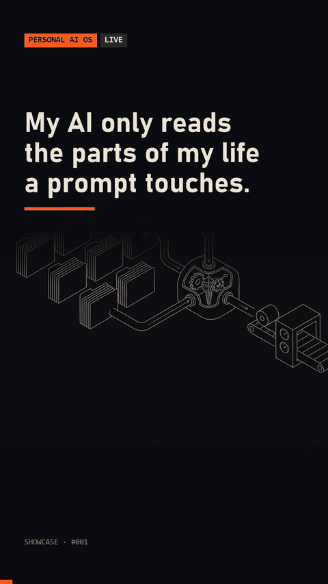

# dominio-router

A prompt router for Claude Code that injects only the life areas a prompt touches. Each area is one markdown file of current values plus a skill; a UserPromptSubmit hook classifies the prompt, injects the matching files and the sections they need from other areas, and flags stale ones. Tested by replaying past prompts.



## Quick start

```
python demo.py
```

Tests: `python -m unittest discover -s tests`. Other commands: `python -m router check`, `python -m router replay tests/replay.jsonl`, `python -m router route "your prompt"`.

## Requirements

Python 3.8+. No dependencies.

## How it works

- Each file in `areas/` has frontmatter (`keywords`, `needs`, `updated`) and a markdown body. The sample areas hold made-up data.
- `router/hook.py` is a `UserPromptSubmit` hook. It matches keywords on word boundaries, so "rental" does not trigger "rent".
- A matching area is injected once per session; later prompts on the same topic add nothing.
- `needs` pulls named sections from other areas, for example money pulls the Trips section of travel, and nothing else.
- An area whose `updated` date is older than `ROUTER_STALE_DAYS` (default 45) is flagged so the model verifies it live before quoting.
- `tests/replay.jsonl` holds prompts with the areas they must route to; changing a keyword that breaks one fails the suite.

Hook wiring (`settings.json`):

```json
{"hooks": {"UserPromptSubmit": [{"hooks": [{"type": "command", "command": "python router/hook.py"}]}]}}
```

## License

MIT. See [LICENSE](LICENSE).

Built with Claude Code. More: https://made-by-asking.pages.dev/showcase/dominio-router/
